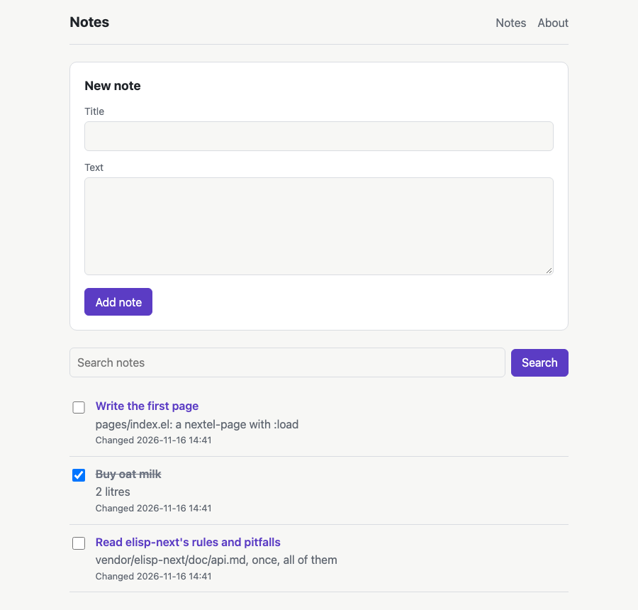

# elisp-web-starter

ページもサーバーも Emacs Lisp で書いた Web アプリケーションの、コピーしてすぐ使えるひな形です。画面、API ルート、両側で検査するレコードの型、SQL のデータベース、テストがそろっています。動作を確かめた版を固定してあり、起動もテストもコマンド1つです。

[English](README.md)



- **ページ** は、WebAssembly にコンパイルした GNU Emacs 30.2 がブラウザのタブの中で動かします（[wasmacs](https://github.com/modeverv/wasmacs)）。部品は [elisp-react](https://github.com/modeverv/elisp-react)（React の Emacs Lisp 版）、画面とルーティングは [elisp-next](https://github.com/modeverv/elisp-next) を使います。`pages/` のファイルがそのままアドレスになります。
- **サーバー** は、ネイティブの GNU Emacs（`./run.sh`）が [elisp-studio](https://github.com/modeverv/elisp-studio) の `app-server.el` の上で動かします。`api/` のファイルがルートになります。データは SQLite に置きます（共用サーバーでは MySQL）。
- **両者の間** では、`shared/` がレコードの型を定義します（`nextel-defschema`）。ページとサーバーが同じファイルを読み込み、やり取りするデータを検査します。

## 始め方

```sh
git clone https://github.com/modeverv/elisp-web-starter my-app    # GitHub の「Use this template」でもよい
cd my-app
./run.sh                 # http://127.0.0.1:8018/ を開く
```

必要なのは bash と、SQLite 付きの GNU Emacs 29 以降だけです。macOS なら Homebrew の `emacs` か Emacs.app、Ubuntu なら `apt install emacs-nox` で入ります。インストールするものはありません（`package.json` はコマンドに名前を付けているだけです）。初めて開いたとき、ページは自分が使う Emacs（約 5MB）を wasmacs のサイトからダウンロードします。固定した版をプロジェクトに置きたい場合は `./fetch-emacs.sh` を実行します。

```sh
test/run.sh              # ルートが最新か、lint（警告はエラー）、テスト。ブラウザもネットワークも不要
npm run test:e2e         # 同じアプリケーションをヘッドレス Chrome で（Node 24、Chrome が必要）
```

## 中身

ノートの一覧です。書く、検索する、完了にする、読む、直す、消す、ができます。`/about` には、2つの Emacs、データベース、固定した版が表示されます。各部分は、実際のアプリケーションで同じことをするときの書き方の見本です。

| 場所 | 見本になること |
|---|---|
| `shared/starter-types.el` | レコードの型（`starter-note`、`starter-draft`、`starter-health`）。検査関数 `starter-check-draft` は1つだけで、ページが送る前に使い、サーバーがもう一度使います。 |
| `api/_notes.el` | サーバー側の関数。SQLite と MySQL の両方のテーブル定義（初回に自動で作られます）、値は `?` パラメーターでのみ渡すこと、`%` と `_` が文字どおりに一致する検索。 |
| `api/notes.el`、`api/notes/[id].el`、`api/health.el` | `:accepts` と `:returns` を付けたルート。誤ったフィールドは 400（どのフィールドかを示す）、無いノートは 404、扱わないメソッドは 405 になります。 |
| `pages/index.el` | `:load` でデータを読む画面。検索は自分のアドレスを持ちます（`#/?q=milk`）。フォームと、`PUT` を送るチェックボックスもあります。 |
| `pages/notes/[id].el` | `:loading`、「Try again」付きの `:error`、文書のタイトルを決める `:head`、その場での編集、確認を挟んだ削除。 |
| `pages/_parts/note-form.el` | 新規と編集で共通のフォーム。自分の検査の結果も、サーバーの拒否も表示します。 |
| `test/starter-test.el` | API と、サーバーにつないだ画面を、ネイティブの Emacs 1つでテストします。ページのリクエストにはサーバーが答えます。 |
| `test/e2e.mjs` | 同じ流れを Chrome で行います。再読み込みしてもデータがサーバーに残っていることも確かめます。 |

## コマンド

| | |
|---|---|
| `./run.sh [PORT]` | `http://127.0.0.1:8018/` で配信します。データは `.data/app.db` に入ります。Ctrl-C で止まります。 |
| `test/run.sh` | 検査です。`nextel-routes --check` のあと、すべての `.el` を警告をエラーとしてコンパイルし（ページ側とサーバー側を別々の Emacs で）、ERT のテストを実行します。 |
| `npm run test:e2e` | プロジェクトのコピーで `./run.sh` を起動し、ヘッドレス Chrome で操作します。 |
| `vendor/elisp-next/bin/nextel-routes` | `pages/`、`api/`、`shared/` のファイルを足したり、消したり、名前を変えたりしたあとに、`routes.el` と `index.html` の script タグを書き直します。`--watch` を付けると変更のたびに書き直します。 |
| `./fetch-emacs.sh [--core]` | `VERSIONS` のブラウザ用 Emacs を `vendor/wasmacs/` に置きます。170MB、`--core` なら 45MB で、このアプリケーションには `--core` で足ります。以後は `./run.sh` が配信します。 |
| `tools/vendor.sh [--check]` | `VERSIONS` のライブラリを `vendor/` と `server/` に置きます。`--check` を付けると比べるだけです。 |

## 版

版を書く場所は [`VERSIONS`](VERSIONS) の1か所だけです。`tools/vendor.sh` がライブラリを GitHub からちょうどそのコミットで、API 文書ごとコピーします。コピーが変わっていないことは CI が確かめます。

| 部分 | 版 | プロジェクト内の場所 |
|---|---|---|
| elisp-next | v0.1.2 の Lisp（コミット `95f3d4b`。日本語の API 文書付き） | `vendor/elisp-next/`（`doc/api.md`、`doc/api.ja.md`） |
| elisp-react | `3bbe842` | `vendor/elisp-react/`（`js/`、`lisp/`、`doc/api.md`、`doc/api.ja.md`） |
| elisp-studio | `2778910` | `server/`（`app-server.el`、`serve-project.el`、`serve-cgi.el`、その README）、`run.sh`、公開用のファイル |
| wasmacs（ブラウザ用 Emacs） | `814bcfd`、ビルド `19ee2aa8…` | `./fetch-emacs.sh` のあとは `vendor/wasmacs/`。実行しなければ、wasmacs のサイトにある最新のビルド |
| GNU Emacs（ネイティブ） | SQLite 付きの 29 以降 | 29.3（Ubuntu、CI）と 31.1（macOS）で確認 |
| Node、Chrome | Node 24 以降 | `npm run test:e2e` にだけ使います |

版を変えるときは、`VERSIONS` を書き換えてから `tools/vendor.sh`、`vendor/elisp-next/bin/nextel-routes`、`test/run.sh`、`npm run test:e2e` の順に実行します。CI は、push のたびと毎週月曜に、固定した版と最新版の両方のブラウザ用 Emacs でブラウザのテストを実行します。毎週の実行で、新しく clone したものがまだ動くかが分かります。

## 自分のアプリケーションにする

1. リポジトリを作ります。GitHub の「Use this template」を使うか、clone してから履歴を新しく始めます（`rm -rf .git && git init`）。
2. 名前を付けます。`pages/_layout.el` の `starter-name` と、`index.html` の `<title>` を変えます。Lisp の接頭辞 `starter-` は、そのままでも構いません。変えるならテストも含めて全部変えます。
3. ノートを自分のレコードに置き換えます。手順（型、サーバー、画面、ルート、テスト）と、elisp-next と elisp-react の規則に加えてこのプロジェクトが決めている規則は、[AGENTS.md](AGENTS.md) にあります。

## コーディングエージェント向け

[AGENTS.md](AGENTS.md) はエージェントのための文書で、`CLAUDE.md` はそれを指しています。コマンド、読む順番（コードと一致する `vendor/` の API 文書）、ファイルの場所、機能の足し方、完了の条件（`test/run.sh`、`npm run test:e2e`、`tools/vendor.sh --check`）が書いてあります。ライブラリの Agent Skill（`vendor/elisp-next/SKILL.md`、`vendor/elisp-react/SKILL.md`）も同梱しています。

## 公開する

サーバーには Emacs が必要なので、静的なホスティング（GitHub Pages）だけでは動きません。公開用のファイルは elisp-studio のキットから来ていて、テストは elisp-studio 側で行っています。このスターター自身のテストが確かめているのは `./run.sh` だけです。

- **リバースプロキシの後ろで動かす：** `PUBLIC_ORIGIN=https://example.com ./run.sh`。`server/deploy/` に Caddyfile、nginx.conf、systemd のユニットがあります。`WORKERS=4` を付けると Emacs が4つ起動します。
- **Docker で動かす：** `docker compose up -d --build` のあと、`http://localhost:8080/` を開きます。
- **CGI が動く共用サーバーに置く**（さくらのレンタルサーバーなど）：`server/cgi/deploy.sh SSH-HOST WEB-DIR APP-DIR https://example.com`。リクエストごとに Emacs が1つ起動し、データは MySQL に置きます（`server/cgi/make-mycnf.sh`）。ノートのテーブルは最初のリクエストで作られます。

詳しくは [server/README.md](server/README.md) の「Publishing it」「With Docker」「On a shared host」にあります。

## ライセンス

このスターター自身のファイルは [0BSD](LICENSE) です。条件はなく、自由に使えます。elisp-studio のキットから来たファイル（`run.sh`、`backup.sh`、`server/cgi/`、`server/deploy/`、Docker 用のファイル）も同じです。ライブラリはそれぞれの MIT ライセンスのままです（`vendor/elisp-next/LICENSE`、`vendor/elisp-react/LICENSE`（`test/lib/cdp.mjs` も対象）、`server/LICENSE`）。ブラウザ用の Emacs は GNU Emacs で、GPL です。`./fetch-emacs.sh` を実行したあと `vendor/wasmacs/` を配信するサイトは、それを配布することになるので、`vendor/wasmacs/licenses/` を一緒に置いてください。アプリケーションの Lisp はその Emacs の中で動き、訪問者全員に送られます。そのため、GPL と両立するライセンスにしてください（0BSD も MIT も両立します）。
