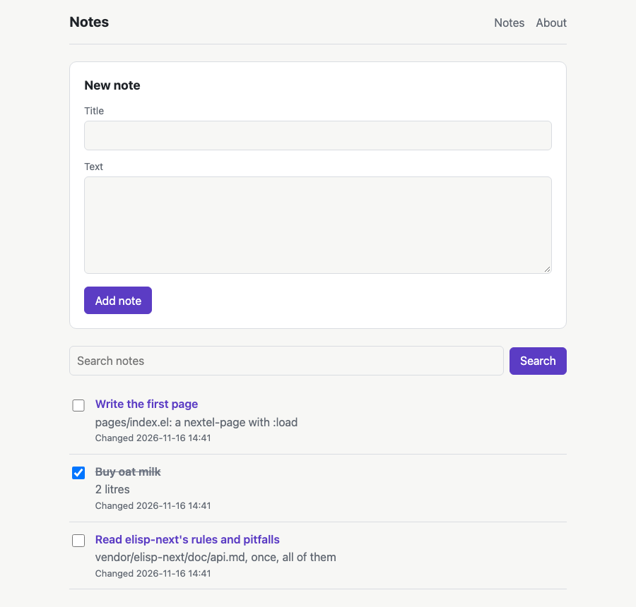

# elisp-web-starter

A web application written in Emacs Lisp on both sides, ready to copy. It has pages, API routes, record types that both sides check, an SQL database, and tests. The versions it was tested with are pinned, and you start it with one command and test it with another.

[日本語](README.ja.md)



- **The page** is GNU Emacs 30.2, compiled to WebAssembly and running in the browser tab ([wasmacs](https://github.com/modeverv/wasmacs)). Its components come from [elisp-react](https://github.com/modeverv/elisp-react) (React in Emacs Lisp), and its pages and routes from [elisp-next](https://github.com/modeverv/elisp-next): a file of `pages/` is an address.
- **The server** is a native GNU Emacs (`./run.sh`), built on [elisp-studio](https://github.com/modeverv/elisp-studio)'s `app-server.el`. A file of `api/` is a route. The data is in SQLite, or MySQL on a shared host.
- **Between them**, `shared/` defines the records (`nextel-defschema`). The page and the server load the same file and check what crosses.

## Start

```sh
git clone https://github.com/modeverv/elisp-web-starter my-app    # or "Use this template" on GitHub
cd my-app
./run.sh                 # then open http://127.0.0.1:8018/
```

All you need is bash and GNU Emacs 29 or later with SQLite. On macOS, that is Homebrew's `emacs` or Emacs.app; on Ubuntu, `apt install emacs-nox`. There is nothing to install: `package.json` only names the commands. On its first visit the page downloads its Emacs (about 5 MB) from the wasmacs site. Run `./fetch-emacs.sh` to keep the pinned one in the project instead.

```sh
test/run.sh              # routes up to date, lint (warnings are errors), tests: no browser, no network
npm run test:e2e         # the same application in headless Chrome (Node 24, Chrome)
```

## What it is

A list of notes. You can write one, search them, mark one done, read, change and delete it. `/about` shows both Emacsen, the database and the pinned versions. Each part shows how a real application does the same thing:

| Where | What it shows |
|---|---|
| `shared/starter-types.el` | Record types (`starter-note`, `starter-draft`, `starter-health`), and one check (`starter-check-draft`) that the page runs before it sends and the server runs again. |
| `api/_notes.el` | The server's functions: the table for SQLite and MySQL, made on first use; values only as `?` parameters; a search whose `%` and `_` match only themselves. |
| `api/notes.el`, `api/notes/[id].el`, `api/health.el` | Routes with `:accepts` and `:returns`. They answer 400 with the field that is wrong, 404 for a note that is not there, and 405 for a method nobody handles. |
| `pages/index.el` | A page whose data comes from `:load`, a search that has its own address (`#/?q=milk`), a form, and a checkbox that sends a `PUT`. |
| `pages/notes/[id].el` | `:loading`, `:error` with Try again, `:head` (the document's title), changing in place, and deleting after a second question. |
| `pages/_parts/note-form.el` | One form for new and changed notes. It reports both its own check and the server's refusal. |
| `test/starter-test.el` | The API, and the pages with the server behind them, in one native Emacs. Each request of the page is answered by the server. |
| `test/e2e.mjs` | The same steps in Chrome, plus a reload, which shows that the server keeps the data. |

## Commands

| | |
|---|---|
| `./run.sh [PORT]` | Serves the application at `http://127.0.0.1:8018/`. The data is in `.data/app.db`. Ctrl-C stops it. |
| `test/run.sh` | The check: `nextel-routes --check`, compiling every `.el` file with warnings as errors (the page's and the server's each in an Emacs of its own), then the ERT tests. |
| `npm run test:e2e` | Headless Chrome against `./run.sh`, on a copy of the project. |
| `vendor/elisp-next/bin/nextel-routes` | Writes `routes.el` and `index.html`'s script tags after a file of `pages/`, `api/` or `shared/` was added, removed or renamed. `--watch` keeps doing it. |
| `./fetch-emacs.sh [--core]` | The browser's Emacs of `VERSIONS`, into `vendor/wasmacs/`: 170 MB, or 45 MB with `--core`, which is enough for this application. `./run.sh` then serves it. |
| `tools/vendor.sh [--check]` | The libraries of `VERSIONS`, into `vendor/` and `server/`. With `--check` it only compares them. |

## Versions

[`VERSIONS`](VERSIONS) is the one place they are written. `tools/vendor.sh` copies the libraries from GitHub at exactly those commits, together with their API documents, and CI checks that the copies are unchanged.

| Part | Version | In the project |
|---|---|---|
| elisp-next | the Lisp of v0.1.2 (commit `95f3d4b`, with the API in Japanese) | `vendor/elisp-next/` (`doc/api.md`, `doc/api.ja.md`) |
| elisp-react | `3bbe842` | `vendor/elisp-react/` (`js/`, `lisp/`, `doc/api.md`, `doc/api.ja.md`) |
| elisp-studio | `2778910` | `server/` (`app-server.el`, `serve-project.el`, `serve-cgi.el`, its README), `run.sh`, the deployment files |
| wasmacs (the browser's Emacs) | `814bcfd`, build `19ee2aa8…` | `vendor/wasmacs/` after `./fetch-emacs.sh`. Without it, the newest build from the wasmacs site. |
| GNU Emacs, native | 29 or later, with SQLite | tested with 29.3 (Ubuntu, CI) and 31.1 (macOS) |
| Node, Chrome | Node 24 or later | for `npm run test:e2e` only |

To change one: edit `VERSIONS`, then run `tools/vendor.sh`, `vendor/elisp-next/bin/nextel-routes`, `test/run.sh` and `npm run test:e2e`. CI runs the browser test with both the pinned and the newest browser Emacs, at every push and every Monday. The weekly run tells you whether a fresh clone still works.

## Making it yours

1. Make the repository: "Use this template" on GitHub, or clone it and start a new history (`rm -rf .git && git init`).
2. Give it your name. Change `starter-name` in `pages/_layout.el` and the `<title>` of `index.html`. The Lisp prefix `starter-` may stay, or you can rename it everywhere, tests included.
3. Replace the notes with your own records. [AGENTS.md](AGENTS.md) has the steps (type, server, page, routes, tests) and the rules this project adds to elisp-next's and elisp-react's.

## For coding agents

[AGENTS.md](AGENTS.md) is written for them; `CLAUDE.md` points to it. It names the commands, what to read in which order (the API documents in `vendor/`, which match the code), where things are, how to add a feature, and when the work is done (`test/run.sh`, `npm run test:e2e`, `tools/vendor.sh --check`). The libraries also come with their Agent Skills (`vendor/elisp-next/SKILL.md`, `vendor/elisp-react/SKILL.md`).

## Publishing it

The server needs Emacs, so a static host (GitHub Pages) is not enough. The files for publishing come from elisp-studio's kit, which is tested there. This starter's own tests run `./run.sh` only.

- **Behind a reverse proxy:** `PUBLIC_ORIGIN=https://example.com ./run.sh`. `server/deploy/` has a Caddyfile, an nginx.conf and a systemd unit, and `WORKERS=4` starts four Emacs processes.
- **With Docker:** `docker compose up -d --build`, then open `http://localhost:8080/`.
- **On a shared host that runs CGI programs** (Sakura's rental server, for one): `server/cgi/deploy.sh SSH-HOST WEB-DIR APP-DIR https://example.com`. Each request is then an Emacs of its own, with the data in MySQL (`server/cgi/make-mycnf.sh`). The notes table is made on the first request.

[server/README.md](server/README.md) ("Publishing it", "With Docker", "On a shared host") says more.

## Licence

This starter's own files are under [0BSD](LICENSE): yours, without conditions. So are the files from elisp-studio's kit (`run.sh`, `backup.sh`, `server/cgi/`, `server/deploy/`, the Docker files). The libraries keep their MIT licences: `vendor/elisp-next/LICENSE`, `vendor/elisp-react/LICENSE` (also for `test/lib/cdp.mjs`) and `server/LICENSE`. The browser's Emacs is GNU Emacs, under the GPL. Once `./fetch-emacs.sh` has run, a site that serves `vendor/wasmacs/` distributes it, and `vendor/wasmacs/licenses/` has to go with it. Your application's Lisp runs inside that Emacs and is sent to every visitor, so keep it under a GPL-compatible licence; 0BSD and MIT both are.
